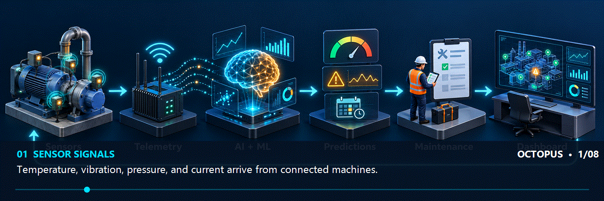

# O.C.T.O.P.U.S.-Operational-Condition-Telemetry-Optimized-Predictive-Uptime-System-

A production-ready B2B Predictive Maintenance platform for industrial clients, combining **Multi-Agent Generative AI (`gemini-3.8-flash`)** with **Machine Learning (`scikit-learn` Random Forests)** for real-time telemetry diagnostics, Remaining Useful Life (RUL) forecasting, and autonomous maintenance dispatching.

## Features

- **Multi-Agent AI Command Center**: 5 specialized industrial AI agents powered by the Google GenAI SDK (`@google/genai` & `google-genai`) using `gemini-3.8-flash` and the Interactions API (`client.interactions.create`), with built-in hybrid ML heuristic fallback
- **Multi-Sensor Data Ingestion**: Temperature, vibration, pressure, acoustic, and electrical current telemetry with automatic threshold-breach agent diagnostics
- **Real-Time Anomaly Detection**: Coupled ML (`RandomForestClassifier`) and LLM root-cause failure mode analysis
- **Remaining Useful Life (RUL) Prediction**: Hybrid ML (`RandomForestRegressor`) and AI agent risk forecasting
- **Autonomous Maintenance Workflows**: Automated work-order generation, operator skill/department matching, step-by-step repair checklists, and completion tracking
- **Stateful Operations Copilot**: Multi-turn conversational AI assistant with live database function calling (`previous_interaction_id` & `tools`)
- **Secure Authentication**: JWT with role-based access control (`ADMIN`, `MANAGER`, `TECHNICIAN`, `OPERATOR`)
- **Industrial Dashboard**: Real-time visualization for operators and administrators
- **System Health Monitoring**: Live API, PostgreSQL database, and Multi-Agent AI status

---

## 3D Project Workflow



## Multi-Agent AI Architecture

Octopus includes **5 specialized AI Agents** orchestrated in `backend/src/services/aiAgentService.ts` and exposed in the Next.js **AI Agents Command Center** (`/dashboard/agents`), plus a Python hybrid telemetry agent in `ai-models/predictive_model.py`:

| Agent ID | Agent Name | Role & Capabilities |
| :--- | :--- | :--- |
| `diagnostic-agent` | **Anomaly & Root-Cause Diagnostic Agent** | Inspects multi-sensor time-series readings, detects threshold & statistical anomalies, identifies root causes, recommends corrective engineering actions, and auto-creates `Alert` records when `POST /api/sensors/reading` breaches thresholds. |
| `predictive-rul-agent` | **Predictive RUL & Risk Forecasting Agent** | Combines statistical feature extraction (mean, standard deviation, threshold excursion ratio) with `gemini-3.8-flash` structured JSON output to forecast Remaining Useful Life (RUL in days), failure probability, and risk score (`0-100`), persisting `Prediction` records. |
| `dispatcher-agent` | **Autonomous Maintenance Dispatcher Agent** | Triages `CRITICAL` and `WARNING` machines, matches active operators/technicians by `department` and `machineGroup`, and autonomously creates prioritized `MaintenanceTask` work orders with 4-step LOTO & repair checklists. |
| `briefing-agent` | **Fleet Optimization & Shift Briefing Agent** | Synthesizes plant-wide machine health, active alerts, RUL forecasts, and IoT sensor battery levels into an executive shift handover briefing and fleet optimization plan. |
| `copilot-agent` | **Octopus Operations Copilot Agent** | Stateful multi-turn conversational assistant using `client.interactions.create` with `previous_interaction_id` and function calling (`get_fleet_summary`, `list_machines`, `run_machine_diagnostics`, `dispatch_maintenance_task`, `acknowledge_active_alerts`). |
| `OctopusTelemetryAgent` | **Python Hybrid ML + Gemini Telemetry Agent** | Located in `ai-models/predictive_model.py`; combines `RandomForestClassifier` & `RandomForestRegressor` predictions with `gemini-3.8-flash` engineering explanations. |

> **Zero-Downtime Hybrid Fallback**: All 5 backend agents and the Python telemetry agent run `gemini-3.8-flash` when `GEMINI_API_KEY` is configured, and automatically fall back to deterministic statistical/ML reliability heuristics when running offline or without an API key.

---

## Technology Stack

### Frontend
- Next.js 16 (App Router)
- React 18 & TypeScript
- Tailwind CSS & Radix UI / ShadCN UI
- Recharts & Framer Motion
- Zustand & TanStack React Query

### Backend
- Node.js & Express.js
- TypeScript
- PostgreSQL 15 & Prisma ORM
- Google GenAI SDK (`@google/genai`) — `gemini-3.8-flash` Interactions API
- JWT Authentication, `bcryptjs`, `helmet`, `express-rate-limit`, `zod`

### AI / ML
- **LLM / Agentic AI**: Google Gemini (`gemini-3.8-flash`) via `@google/genai` (TypeScript) and `google-genai` (Python)
- **Classical ML**: Python, `scikit-learn` (`RandomForestClassifier`, `RandomForestRegressor`, `StandardScaler`), `numpy`, `pandas`, `joblib`

### Deployment
- Docker & Docker Compose

---

## Getting Started

### Prerequisites
- Node.js 18+
- PostgreSQL 15+
- Docker & Docker Compose (optional)
- `GEMINI_API_KEY` (optional — enables live `gemini-3.8-flash` cloud reasoning; hybrid ML engine runs automatically if omitted)

### Quick Start with Docker

1. Clone the repository.
2. Copy `.env.example` to `.env` and set a strong database password, database URL, and JWT secrets. Keep `.env` private.
3. (Optional) Add your Gemini API key to `.env` for live AI reasoning.
4. Start the services:
```bash
docker-compose up -d
```
5. Access the application:
- Frontend: http://localhost:3000
- AI Agents Command Center: http://localhost:3000/dashboard/agents
- Backend API: http://localhost:5000
### Manual Setup

#### Backend Setup

```bash
cd backend
npm install
# Configure DATABASE_URL and optional GEMINI_API_KEY in backend/.env
npm run prisma:generate
npm run dev
```

#### Frontend Setup

```bash
cd frontend
npm install
npm run dev
```

#### Python ML & Telemetry Agent Setup

```bash
cd ai-models
pip install numpy pandas scikit-learn joblib google-genai
python predictive_model.py
```

---

## User Roles

### ADMIN
- View all machine data, sensors, alerts, predictions, and AI agent diagnostics
- Trigger fleet-wide autonomous maintenance dispatching and briefings
- Create and manage operators
- Configure system settings and view system health & audit logs

### OPERATOR / TECHNICIAN / MANAGER
- View machine readings, status, and AI diagnostic reports
- Interact with the **Octopus Operations Copilot** and run on-demand machine diagnostics & RUL forecasts
- Create and update maintenance tasks
- Acknowledge and resolve alerts

---

## API Endpoints

### AI Agents (`/api/agents`)
- `GET /api/agents` - List all 5 AI agents, capabilities, and Gemini configuration status
- `POST /api/agents/diagnose/:machineId` - Run the **Anomaly & Root-Cause Diagnostic Agent** on a machine
- `POST /api/agents/predict-rul/:machineId` - Run the **Predictive RUL & Risk Forecasting Agent** on a machine
- `POST /api/agents/dispatch-maintenance` - Run the **Autonomous Maintenance Dispatcher Agent** to create prioritized work orders
- `GET /api/agents/fleet-briefing` - Run the **Fleet Optimization & Shift Briefing Agent**
- `POST /api/agents/copilot/chat` - Multi-turn tool-calling chat with the **Octopus Operations Copilot Agent**

### Authentication
- `POST /api/auth/login` - User login
- `POST /api/auth/register` - User registration
- `POST /api/auth/forgot-password` - Password reset
- `GET /api/auth/profile` - Get user profile

### Machines
- `GET /api/machines` - List all machines
- `GET /api/machines/:id` - Get machine details
- `POST /api/machines` - Create machine (Admin)
- `PUT /api/machines/:id` - Update machine (Admin)
- `DELETE /api/machines/:id` - Delete machine (Admin)

### Sensors
- `GET /api/sensors` - List all sensors
- `GET /api/sensors/:id` - Get sensor details
- `POST /api/sensors` - Create sensor (Admin)
- `POST /api/sensors/reading` - Ingest sensor reading (auto-triggers Diagnostic Agent on threshold breach)

### Alerts
- `GET /api/alerts` - List all alerts
- `PUT /api/alerts/:id/acknowledge` - Acknowledge alert
- `PUT /api/alerts/:id/resolve` - Resolve alert

### Predictions
- `GET /api/predictions` - List predictions
- `GET /api/predictions/stats` - Get prediction statistics

### Maintenance
- `GET /api/maintenance` - List maintenance tasks
- `POST /api/maintenance` - Create task
- `PUT /api/maintenance/:id` - Update task

### Analytics
- `GET /api/analytics/dashboard` - Dashboard statistics
- `GET /api/analytics` - Full analytics

### Users (Admin only)
- `GET /api/users` - List users
- `POST /api/users/operator` - Create operator
- `PUT /api/users/:id` - Update user
- `DELETE /api/users/:id` - Disable user

### System (Admin only)
- `GET /api/system/health` - System health status (including active AI Agents and Gemini model status)
- `GET /api/system/logs` - System logs

---

## Project Structure

```
octopus/
├── backend/
│   ├── prisma/
│   │   └── schema.prisma             # PostgreSQL database schema
│   ├── src/
│   │   ├── controllers/
│   │   │   ├── agentController.ts    # Multi-Agent AI endpoints
│   │   │   └── ...                   # Auth, Machine, Sensor, Alert, Prediction controllers
│   │   ├── routes/
│   │   │   ├── agentRoutes.ts        # /api/agents routes
│   │   │   └── ...
│   │   ├── services/
│   │   │   └── aiAgentService.ts     # 5 AI Agents (Gemini 3.8 Flash + Hybrid ML fallback)
│   │   ├── middleware/               # JWT Auth & RBAC middleware
│   │   └── index.ts                  # Express entry point
│   └── package.json
├── frontend/
│   ├── app/
│   │   ├── dashboard/
│   │   │   ├── agents/page.tsx       # AI Agents Command Center & Copilot UI
│   │   │   └── ...                   # Machines, Sensors, Alerts, Predictions, Maintenance
│   │   ├── layout.tsx                # Root layout
│   │   └── page.tsx                  # Login page
│   ├── components/                   # Reusable UI components
│   ├── services/
│   │   └── api.ts                    # Typed API client including agentService
│   ├── store/                        # Zustand auth & state stores
│   └── package.json
├── ai-models/
│   └── predictive_model.py           # Random Forest ML + OctopusTelemetryAgent
├── docker-compose.yml                # Docker orchestration
└── README.md
```

---

## Database Schema

### Users
- `id`, `email`, `password`, `name`, `role`, `department`, `operatorNumber`, `machineGroup`, `isActive`, `lastLogin`

### Machines
- `id`, `name`, `type`, `model`, `serialNumber`, `location`, `department`, `machineGroup`, `status`, `healthScore`

### Sensors & SensorReadings
- `id`, `machineId`, `name`, `type`, `unit`, `minValue`, `maxValue`, `thresholdMin`, `thresholdMax`, `isActive`, `batteryLevel`

### Alerts
- `id`, `machineId`, `severity`, `status`, `title`, `message`, `sensorType`, `value`, `threshold`, `createdAt`

### Predictions
- `id`, `machineId`, `failureProbability`, `rul`, `riskScore`, `confidence`, `status`, `modelVersion`, `predictionDate`

### MaintenanceTask
- `id`, `machineId`, `assignedTo`, `title`, `description`, `type`, `priority`, `status`, `scheduledDate`

### SystemLog
- `id`, `userId`, `action`, `entityType`, `entityId`, `details`, `createdAt`

---

## Security Features

- Password hashing with `bcryptjs`
- JWT authentication with access and refresh tokens
- Role-based access control (`ADMIN`, `MANAGER`, `TECHNICIAN`, `OPERATOR`)
- Input validation with `zod`
- Rate limiting (`express-rate-limit`) & HTTP security headers (`helmet`)
- CORS configuration
- Comprehensive audit logging (`SystemLog`) for user and AI agent actions

## License

This project is licensed under the MIT License. See [LICENSE](LICENSE) for details.

